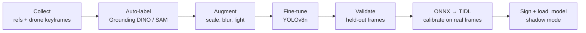
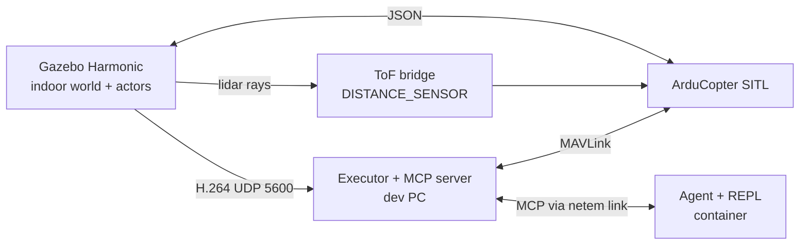

# HORUS — Design Document v2

Sep 24, 2026 · @hasan\_piker

## Summary

HORUS is a drone you direct instead of pilot: a cloud AI decides *what* to do, an onboard executor decides *how*, and ArduPilot decides *whether it is safe*. The primary use case is indoor search and rescue; the platform is civilian, non-weaponized, privacy-aware and always human-overridable.

**Research question:** how can a slow, remote AI model reliably direct a fast physical system over a delayed or intermittent link, while staying task-general?

**Method in one line:** the cloud grounds tasks by picking targets on camera frames, a class-agnostic onboard layer executes them in real time with latency compensation, and specialist recognition is added on demand without redesigning the system.

### What changed from v1

- **Scope is tiered.** A must-have core answers the research question; offline autonomy and modules are stretch goals; distillation-at-scale, local LLM and VIO are future work.
- **Grounding uses IDs, not pixels.** Onboard proposals are marked with tracker IDs and the cloud picks an ID (set-of-mark). The grounding model becomes a fallback and an auto-labeler.
- **Latency compensation has a concrete mechanism:** frame buffer with fast-forward tracking, embedding re-match, slow-down while waiting, check on arrival.
- **Specialist training is a ladder** the manager agent climbs: embeddings → tiny classifier head → agent-triggered YOLOv8n fine-tune with a frozen, pre-validated architecture.
- **Optional ground-station edge tier** (laptop GPU on the LAN) for low-latency grounding.
- **Simulation plan** with ArduPilot SITL + Gazebo is now concrete, with milestones.
- **Headline experiments** are the latency sweep and cloud-only vs. HORUS.

## Principles and architecture

The priority order is Safety > Failsafe/RTH > Local executor > Cloud brain, and the core must fly safely with zero modules and zero cloud.

- **Semantics in the cloud, geometry onboard.** The drone never needs to understand what things are; it handles space, motion, identity-by-comparison and "that tracked thing."
- **Safety is deterministic.** Avoidance, geofence and RTH never depend on a model.
- **The AI never sends raw motor or velocity commands.** Only bounded skills with clamped speeds and distances.
- **Simulation first.** Every feature runs in SITL + Gazebo before real flight.


The commander plans and reports; the grounding model is called only when onboard proposals miss the target; the training service is called only when the recognition ladder needs a specialist (Section: Specialized recognition).

| Tier | Runs | Rate | Examples |
| --- | --- | --- | --- |
| Cloud commander | Frontier model (Claude / GPT-class / Qwen) | ≤ 1 Hz, event-driven | Plan, pick target ID, ask operator, report |
| Ground-station edge (optional) | Laptop GPU on the same LAN | 3–10 Hz | Grounding DINO / Florence-2 fallback pointing |
| Onboard executor | AI board (BeagleY-AI / AM67A class) A53 cores + accelerator | 10–30 Hz | Tracking, ReID, approach, orbit, scan, `run_plan` |
| Flight control | ArduPilot on a dedicated flight controller | 400 Hz | Stabilization, avoidance, failsafes |

Executor states (`ExecutorState` in `horus/executor/core.py`): `IDLE → EXECUTING → HOLDING → RTH`, plus `PILOT` whenever a pilot or autopilot failsafe takes over. `OFFLINE_MISSION` and `RETURNING_TO_LINK` are planned states for disconnected autonomy (stretch) and do not exist yet. Every command has a time-to-live: a queued command that expires is dropped, and a running one that expires is stopped and the executor holds in GUIDED.

## Scope tiers

The must-have core alone answers the research question; everything else is added only once the core flies reliably.

| Tier | Includes | Demo scenarios |
| --- | --- | --- |
| **Must-have core** | Dual-system loop, set-of-mark grounding, latency compensation, safety layer, bounded MCP tools, REPL, recognition ladder steps 1–2 (embeddings, tiny head) | Find the person in the red shirt · Follow that person with occlusion · Link cut with no package → hold → RTH → AprilTag landing |
| **Stretch** | Agent-triggered YOLOv8n fine-tune (ladder step 3), offline mission packages + store-and-forward, one thermal module, ground-station edge tier | Search room for someone lying down · Link cut mid-mission → continue → return to link zone → sync · Ambiguity: drone asks before acting |
| **Future work** | Full module manager with DroneCAN auto-discovery, local LLM for offline decisions, VIO, multi-drone | — |

Scripted, replayable REPL missions are part of the core because every experiment depends on them.

## Real-time grounding and latency

The cloud picks a tracker ID, not a pixel box, so a late answer is still correct and the frontier model never outputs coordinates.

### Primary: set-of-mark ID pointing

1. Onboard, a class-agnostic detector proposes candidates and the tracker assigns persistent IDs.
2. The drone sends a timestamped, downscaled frame (e.g. 640 px JPEG) with numbered marks drawn on each candidate, plus a small table of IDs, boxes and attributes.
3. The commander answers with an ID ("approach ID 3 to 2 m").
4. The tracker has kept ID 3 alive the whole time, so the executor acts on the current position immediately.

### Fallback: grounding model

Used only when the target is not among the proposals (unusual object, small, partly hidden). The commander calls the pointer with the frame ID and a description, and the executor brings the returned box up to date:

- **Fast-forward tracking:** a 1–3 s ring buffer of frames onboard; initialize the tracker on the old frame and replay the buffer to the present.
- **Embedding re-match:** crop the returned box from the old frame, embed it, and match against current detections. Robust when the target moved a lot.
- **Check on arrival:** if the updated box matches nothing above a confidence threshold, discard it and re-query with a fresh frame.

### Reducing latency itself

- **Slow down while waiting:** with a query pending, the executor hovers or caps speed, so there is less to compensate.
- **Small payloads:** compressed low-res frames or region crops only.
- **Ground-station edge tier:** run the grounding model on a laptop GPU on the same LAN; the commander stays in the cloud.
- **Event-driven queries:** call the cloud when tracking confidence drops, a skill finishes, something unexpected appears, or the executor is unsure; never on a timer.

Every frame carries frame ID + timestamp + drone pose, and every observation sent to the cloud states its age.

## Specialized recognition

The manager agent climbs a three-step ladder and stops at the first step that works; fine-tuning is the last resort, not the default.

| Step | Method | Time to ready | Where it runs | Best for |
| --- | --- | --- | --- | --- |
| 1 | Class-agnostic detector + embedding match against reference crops | Seconds | Onboard, no training | A specific person (ReID / face), a specific object |
| 2 | Tiny classifier head on frozen-backbone embeddings, 20–100 crops | Seconds to 1 min | Onboard CPU or cloud | A small set of look-alike objects |
| 3 | Fine-tuned YOLOv8n, auto-labeled | \~15–45 min | Cloud GPU + TIDL compile | A *type* of object or shape (valve model, crack, debris), long offline missions |

For a specific person, stay on step 1: fine-tuning YOLO on one person from a few photos teaches "person", not "this person". Identity is an embedding problem.

### Step 3 pipeline (planned MCP tool `train_specialist`)



Planned, not yet registered: the commander calls `train_specialist(description, reference_images)`, which returns a `task_id`; the job runs in the cloud and the drone keeps working on step 1 or 2 meanwhile. The result is loaded with the equally planned `load_model(package)`.

- **Frozen architecture:** one YOLOv8n configuration is proven once to compile on TIDL with no CPU fallback layers; afterwards only weights change, so compilation is predictable.
- **Data from the drone's own camera:** recent keyframes are included so the training data matches the real viewpoint and sensor.
- **Quality gate:** below a set mAP on held-out frames, the model is rejected and the agent falls back to embeddings.
- **Shadow mode:** the specialist runs next to the generic detector for a short check before its candidates are trusted.
- **Safe loading:** mode switches only while hovering; a specialist only proposes candidates and never touches flight or avoidance.

In simulation, step 3 is testable end to end except the TIDL compile, which is validated once on the real board.

## Disconnected autonomy (stretch)

While connected the brain prepares the drone; while disconnected the drone executes and records; on reconnect the brain and operator confirm. Built so far: a `run_plan` plan keeps running onboard without the link (Section: Provider-written plans). Mission packages, store-and-forward and link-aware return below are planned.

**Mission package** (signed, sent before link loss):

| Field | Example |
| --- | --- |
| Goal | Find this person |
| Target profile | Embeddings, attributes, reference crops, optional specialist model |
| Search plan | Area, pattern, altitude |
| Thresholds | Match vs. "maybe" confidence |
| Allowed actions | Observe, record, hover, mark; nothing irreversible |
| Budgets | Max time, battery reserve, max distance |
| Return conditions | Found, time up, battery low, uncertain |

The executor runs the package as a rule-based behavior tree; it never invents new goals.

- **Store-and-forward:** candidates (crops, scores, pose, time), keyframes, coverage, events and link quality per position; uploads best matches first on reconnect.
- **Link-aware return:** fly to the nearest breadcrumb point with good link, retracing the path to limit drift; battery reserve always guarantees reaching home.
- **Link loss is emulated deliberately** with `tc netem` (delay, loss, full cut) on the link interface, in simulation and on hardware. An indoor room has no natural dead zone, so the thesis states this openly; it also makes runs repeatable.
- **Privacy:** person profiles only with a lawful SAR basis (KVKK / GDPR), mission-scoped, deleted after the mission, logs encrypted, matches are candidates for confirmation.

## Safety and MCP interface

A bad AI decision cannot produce a dangerous maneuver: the executor and ArduPilot clamp every speed, distance and geofence, and emergency tools bypass the task queue.

- **Collision avoidance:** ToF ring (4–6× VL53L1X) feeding ArduPilot proximity (`PRX_*`, `AVOID_ENABLE`). Monocular depth may add awareness but is never the only safeguard.
- **Verify avoidance in Guided mode first.** The executor drives the drone in Guided mode, and avoidance behaves differently per flight mode. Milestone S3 in the simulation plan proves the proximity sensors stop executor-issued motion before anything else is built on it.
- **Odometry and RTH:** GPS in the default profile; without GPS, optical flow + downward rangefinder into EKF3 (Section: Navigation source). Home set at takeoff, AprilTag pad for precise landing, breadcrumb retracing as backup (planned).
- **Failsafes:** cloud link lost → the executor holds, and after `link_loss_rth_delay_s` (default 30 s) of hold with no MCP call it returns home (`auto_rth`); a running plan counts as supervision. Planned (stretch): run a mission package if any, return to the link zone, then RTH. Low battery → RTH with enforced reserve. Hardware RC override always available.
- **Pilot override is final.** Any armed flight-mode change HORUS did not request (RC mode switch, GCS, ArduPilot battery/fence/EKF failsafe) cancels all HORUS work, enters `PILOT` state, publishes `pilot_override`, and refuses every flight tool, emergencies included, until the vehicle is switched back to GUIDED (`pilot_released`) or disarmed. HORUS only re-sends GUIDED when telemetry does not already report it, so a stale GUIDED report never undoes a pilot's switch.

| Category | Tools |
| --- | --- |
| State | `get_state`, `get_frame`, `list_candidates`, `get_map`, `get_link_status` |
| Skills | `take_off(altitude_m)`, `goto(pose)`, `follow(id, dist_m, target_size_m)`, `orbit(id, radius_m, target_size_m)`, `scan(area)`, `search(area, cue)` (cue: `class_name`, `attribute` + `equals`, or `reference_id`), `approach(id, dist_m, target_size_m)` |
| Grounding | `set_vocabulary(terms)` (continuous open-vocabulary detection), `point(frame_id, description|box)` (may seed a new tracker ID) |
| Scene | `get_candidate_motion(id)`, `watch_region(name, box, class_name)`, `list_region_watches`, `remove_region_watch(watch_id)` |
| Recognition | `set_target_profile(profile)`, `set_mode(name)`; planned (stretch, not registered): `train_specialist(desc, refs)`, `load_model(package)` |
| Tasks | `get_task_status(task_id)`, `wait_for_task(task_id, timeout_s)`, `wait_events(after_id, timeout_s)`, `cancel(task_id)` |
| Plans | `run_plan(plan, ttl_s)`, `get_plan_status(plan_id)`, `wait_for_plan(plan_id, timeout_s)`, `cancel_plan(plan_id)` |
| Missions (planned, stretch; not registered) | `upload_mission`, `start_mission`, `get_mission_log`, `clear_mission` |
| Emergency | `hold`, `rth`, `land` |

Skills take tracker IDs rather than pixel regions. Long actions return a `task_id` immediately. `wait_events` blocks asynchronously until an executor or perception transition arrives (or its timeout expires), so the commander can observe task completion, target loss/reacquisition, link state, emergency actions, and perception changes without polling. Event kinds are registered in `horus/events.py`: executor (`task_finished`, `target_lost`, `target_reacquired`, `target_found`, `link_lost`, `link_restored`, `auto_rth`, `emergency`, `landed`, `precision_landing_stalled`, `pilot_override`, `pilot_released`), plan (`plan_finished`, `plan_log`) and scene (`object_detected` and the `watch_region` kinds `region_enter`, `region_exit`, `region_dwell`, `region_watch_paused`, `region_watch_resumed`, `region_watch_expired`). Every registered kind except `plan_log` may wake the commander model; `vocabulary_changed` stays on the `wait_events` stream only. The server also offers its operating guidance as the `horus_commander` prompt and the `horus://mission/brief` resource. Every state and frame response is timestamped. The server is authenticated (bearer token), reached only through an encrypted tunnel, and built on the Python MCP SDK over streamable HTTP, with pymavlink to ArduPilot.

### Provider-written plans (`run_plan`)

HORUS is a provider-agnostic MCP server: any MCP client and model can command it, and the provider decides whether to drive step by step or to plan. `run_plan` lets it send a whole mission as one short program, following TypeFly's plan format (restricted Python; [TypeFly](https://github.com/typefly/TypeFly), Apache-2.0). TypeFly's original MiniSpec language was dropped by its authors in December 2025; MCP tool calls cannot stream partial arguments, so MiniSpec's stream interpreting does not apply, and a measured "find and orbit the person in red" mission is 147 tokens over 8 tool turns as separate calls, 71 tokens in one turn as a plan, and 53 as MiniSpec. The win is the single round trip, not the syntax.

- **Grammar:** plan-function calls, single-name assignment, `if/elif/else`, `for i in range(<integer literals>)` (≤ 100 iterations, ≤ 1000 nested), `break/continue/pass`, comparisons, `and/or/not`, float `+ - * /`, f-strings. HORUS interprets the AST itself, so nothing outside the plan functions is reachable.
- **Functions:** `take_off(altitude_m)`, `goto(north_m, east_m, up_m)`, `approach(id, dist_m)`, `follow(id, duration_s)`, `orbit(id, duration_s)`, `scan(north_min_m, north_max_m, east_min_m, east_max_m)`, `search(<same area>, class_name|attribute+equals|reference_id) → id or -1`, `wait(seconds)`, `log(message)`, `hold/rth/land` (end the plan). Each flight call is an ordinary clamped executor skill and returns success so the plan can branch.
- **Safety:** one plan at a time; while it runs, direct skill tools are refused. Emergencies (`hold/rth/land`) and pilot override abort it at the next statement or while a step runs. Plan TTL defaults to 600 s (max 1800 s). A running plan counts as onboard supervision, so link-loss RTH cannot fire until it ends; ArduPilot battery and fence failsafes still apply.
- **Events:** `plan_log` per `log()` line (log and GUI only, never wakes the model), `plan_finished` at the end.

### Navigation source

GPS flight is the default on every shipped world: the indoor room (`horus_indoor`), the canonical outdoor worlds (`horus_forest`, `horus_urban`) and generated procedural worlds (`horus_<kind>_p<seed>`). The SITL parameters are composed from fragments in `config/ardupilot/`: `common.parm` (proximity avoidance, downward rangefinder, gimbal) followed by `indoor.parm`, or by `outdoor.parm` plus `canonical_fence.parm` or `procedural_fence.parm`. `sim/scripts/world_profiles.py` maps each world to its executor config and fragment list; `HORUS_SITL_PARAM_FILE` overrides it. The GPS-free profile (optical flow into EKF3, barometer altitude, downward rangefinder) is `nogps.parm` loaded after `common.parm` and `indoor.parm` (`sim/scripts/s4_landing_trials.sh`); it stays maintained so the same stack can fly without GPS when needed.

### Flight controller

ArduPilot runs on a dedicated flight controller; the AI board (BeagleY-AI / AM67A class with CNN accelerator) is the companion computer for the executor, perception and MCP server.

## Simulation plan (ArduPilot SITL + Gazebo)

Start with Gazebo Harmonic on Ubuntu 22.04 and the official [ardupilot\_gazebo](https://github.com/ArduPilot/ardupilot_gazebo) plugin; the plugin repo recommends Harmonic and also supports Garden, Ionic and Jetty. The same ArduPilot firmware runs in SITL and on the real board, so everything above the flight controller carries over unchanged.

### Setup

1. Install Gazebo Harmonic (binary install) and check it runs: `gz sim -v4 -r shapes.sdf`.
2. Set up the ArduPilot development environment and confirm plain SITL runs with MAVProxy.
3. Install plugin dependencies, then build the plugin:

```bash
sudo apt install libgz-sim8-dev rapidjson-dev libopencv-dev \
  libgstreamer1.0-dev libgstreamer-plugins-base1.0-dev \
  gstreamer1.0-plugins-bad gstreamer1.0-libav gstreamer1.0-gl
git clone https://github.com/ArduPilot/ardupilot_gazebo
cd ardupilot_gazebo && mkdir build && cd build
cmake .. -DCMAKE_BUILD_TYPE=RelWithDebInfo && make -j4
echo 'export GZ_SIM_SYSTEM_PLUGIN_PATH=$HOME/ardupilot_gazebo/build:${GZ_SIM_SYSTEM_PLUGIN_PATH}' >> ~/.bashrc
echo 'export GZ_SIM_RESOURCE_PATH=$HOME/ardupilot_gazebo/models:$HOME/ardupilot_gazebo/worlds:${GZ_SIM_RESOURCE_PATH}' >> ~/.bashrc
```

4. First flight, in two terminals:

```bash
gz sim -v4 -r iris_runway.sdf
sim_vehicle.py -v ArduCopter -f gazebo-iris --model JSON --map --console
# in MAVProxy: mode guided → arm throttle → takeoff 5
```

5. Camera: attach the plugin's `GstCameraPlugin` to the drone camera; it streams H.264 over UDP (port 5600 by default), which the executor reads with OpenCV/GStreamer exactly as it will read the real CSI camera stream.

### Simulation stack



The agent runs in its own container so `tc netem` delay and loss apply only to the brain link, never to MAVLink.

### World and sensors

- **Indoor world (`horus_indoor`):** a room and corridor with furniture, a textured floor and an AprilTag pad; Gazebo actors (animated people) in different shirt colors, one lying on the floor.
- **Outdoor worlds:** the canonical `horus_forest` and `horus_urban`, and procedurally generated forest/urban worlds (`horus_<kind>_p<seed>`), all flown on GPS with an ArduPilot fence.
- **GPS-free flight (S4):** `nogps.parm` disables the SITL GPS and flies on SITL's simulated optical flow into EKF3, with the downward rangefinder from the ToF bridge. Every other profile flies on GPS (Section: Navigation source).
- **ToF ring:** six short-range Gazebo lidar sensors plus a downward range sensor indoors (one 8-beam ring lidar on the procedural payload), read by a small bridge that sends MAVLink `DISTANCE_SENSOR` messages, with ArduPilot proximity set to the MAVLink type (`PRX1_TYPE 2`).
- **Perception in sim** runs on the dev PC (PyTorch / ONNX). Cap its frame rate to what the AI board's accelerator is expected to sustain, so behavior does not depend on desktop-class compute.

### Milestones

| # | Milestone | Done when |
| --- | --- | --- |
| S0 | Toolchain | Iris flies `takeoff 5` in `iris_runway.sdf` |
| S1 | MAVLink control | Python script (pymavlink or MAVSDK) takes off, flies a square, lands in Guided mode |
| S2 | MCP server + REPL | `/state`, `/goto`, `/hold`, `/rth` work from the REPL; skills return `task_id`s |
| S3 | Safety proof | Indoor world + ToF bridge: executor-issued `goto` toward a wall is stopped by proximity avoidance in Guided mode |
| S4 | GPS-free | Same missions on optical flow + rangefinder; RTH lands within a set error on the AprilTag pad |
| S5 | Perception + tracking | Camera stream → detector → tracker with persistent IDs; `follow(id)` survives a 2 s occlusion |
| S6 | Cloud loop | Set-of-mark frames to the commander; "find the person in the red shirt" succeeds end to end |
| S7 | Latency | Frame buffer, fast-forward tracking, embedding re-match; latency sweep 0–3 s with `netem` |
| S8 | Stretch | Mission package + link cut; `train_specialist` (planned tool) produces a model the executor loads in shadow mode |

Use `SIM_SPEEDUP` and headless Gazebo runs for batches of repeated trials once scripted REPL missions work.

## Experiments

Two headline experiments answer the research question directly; the rest support them and are run only as time allows.

| Priority | Experiment | Measure |
| --- | --- | --- |
| Headline | Latency sweep: 0, 0.5, 1, 2, 3 s added delay, with vs. without compensation | Task success rate, time to target, wrong-target rate |
| Headline | Cloud-only (LLM sends goto/velocity directly) vs. HORUS dual-system | Success rate, collisions, blocked unsafe commands |
| Secondary | Set-of-mark ID pointing vs. grounding-model boxes | Success rate, latency, pointer errors |
| Secondary | Tracking re-acquisition after occlusion | Re-acquisition rate, time to re-acquire |
| Secondary | Recognition ladder: embeddings vs. tiny head vs. fine-tuned YOLOv8n | Precision/recall, time to ready |
| Secondary | Generalization to target objects and descriptions not used during development | Success rate |
| Secondary | Commander model comparison on identical scripted missions | Success rate, API cost, latency |
| Secondary | RTH accuracy with vs. without AprilTag | Landing error (cm) |
| Stretch | Offline mission: detection and false-match rate offline vs. online; data recovered on sync | Rates, time to reconnect |

Every experiment runs as a scripted REPL mission, N ≥ 20 trials per condition in simulation and a smaller confirming set on hardware.

## Hardware and risks

The companion is an AM67A-class AI board (BeagleY-AI or T3 Gemstone O1: 4× A53 for Linux, 4 TOPS accelerator) next to a separate ArduPilot flight controller, on a 5–7" frame with prop guards; the default-core BOM from v1 (\~$785–1,190, or \~$510–915 with a free board) plus the flight controller.

| Risk | Mitigation |
| --- | --- |
| AI-board ecosystem is new (TIDL toolchain, drivers) | Flight control is on the separate controller, so the board only risks perception; compile models early |
| TIDL operator support | Prove the frozen YOLOv8n and tracker/ReID models compile early, before any training |
| Indoor optical flow drift on plain floors | Textured floor mats, AprilTag landing, breadcrumb retracing |
| ReID trained on eye-level footage fails from above | Early test on drone-view footage; fall back to attributes + fine-tuning if needed |
| Avoidance does not act on Guided-mode motion | Milestone S3 proves it in simulation before hardware |
| Loud, large drone in a small room | Netted test area, props-off and tethered tests first, low speed caps |
| Wi-Fi instability | Command TTL, hold-by-default, failsafes |
| API cost and latency | Event-driven queries, low-res frames, ground-station edge tier |
| False matches offline | Conservative thresholds, confirmation after sync |
| Privacy | Mission-scoped profiles, deletion after mission, encrypted logs |

## Timeline and success criteria

**Minimum viable result:** in simulation and on real hardware, "find the person in the red shirt" and "follow that person" succeed reliably at up to 2 s added latency, with compensation clearly beating no compensation, and zero collisions caused by AI commands.

The timeline is in weeks from the start of simulation work; real dates depend on the submission deadline (open question).

| Weeks | Phase | Milestones |
| --- | --- | --- |
| 1–2 | Toolchain and control | S0, S1 |
| 3–4 | MCP server, REPL, safety proof | S2, S3 |
| 5–6 | GPS-free flight, perception, tracking | S4, S5 |
| 7–9 | Cloud loop and latency compensation | S6, S7 |
| 8 | **Hardware go/no-go:** the flight controller flies stable hover with flow + ToF and the AI board runs perception at target rate, or switch to fallback | Props-off, tethered, low-altitude tests |
| 10–12 | Indoor flights of the core scenarios | Core demos on hardware |
| 12–14 | Stretch goals if the core is solid | S8, thermal module |
| 14–16 | Experiments and write-up | Headline experiments, thesis, demo video |

Hardware bring-up runs in parallel from week 5, so the go/no-go in week 8 is a real decision, not a surprise.

| Scenario | Success criterion |
| --- | --- |
| Find the person in the red shirt | ≥ 80% correct target over 20 sim trials; report names the right location |
| Follow that person | Re-acquires after a 2 s occlusion in ≥ 80% of trials |
| Link cut, no package | Holds, returns home and lands within a set distance of the AprilTag center in every trial |
| Unsafe command injected | Blocked or clamped in 100% of trials |

- [ ] Confirm the submission deadline and team size, then turn weeks into dates

## Related work

HORUS differs from prior LLM-drone work by combining ID-based grounding, onboard latency compensation, a deterministic ArduPilot safety layer and disconnected autonomy on real hardware.

| Project | Summary | Gap HORUS addresses |
| --- | --- | --- |
| [TypeFly](https://arxiv.org/abs/2312.14950v2) (Yale, 2023–24) | A cloud LLM writes programs in a small custom language (MiniSpec, since replaced by restricted Python) that a drone executes, with edge-based vision; the revised version targets LLM response latency | Baseline HORUS builds on: HORUS adopts its plan format as `run_plan` and adds a provider-agnostic MCP interface, tracker-ID grounding, an ArduPilot safety layer with pilot override, and plans that keep running without the link |
| ChatGPT for Robotics (Microsoft, 2023) | ChatGPT generates Python code to fly a simulated drone toward an object, given skills and the object's precise location | Simulation only; object location given; no real-time layer |
| CognitiveDrone / -R1 (Skoltech, 2025) | 7B VLA trained on simulated trajectories; R1 adds a Qwen2.5-VL reasoning module | Simulation only, narrow task, too heavy for edge; dropped from the plan |
| EchoPilot | Voice → local LLM plans a mission → MCP tools over MAVSDK (PX4) | Upfront planning, GPS waypoints, no vision loop or latency handling |
| mavlink-mcp | MCP server letting an LLM fly ArduPilot and see through its camera, SITL-focused | No onboard executor (verify hardware claims before submission) |
| ardupilot-mcp | Safety-gated MCP server for ArduPilot, actuation off by default | Good safety reference; no perception or execution layer |
| LLM-controlled-drone | Local LLM + YOLO feedback controlling PX4 in Gazebo via ROS 2 | Simulation, fixed-class perception |

Techniques HORUS builds on: dual-system control (Figure's Helix, NVIDIA GR00T N1), set-of-mark visual prompting, supervisory control for delayed teleoperation, and Grounding DINO / Florence-2 for open-vocabulary grounding.

- [ ] Verify every entry above against the original papers and repos before submission
