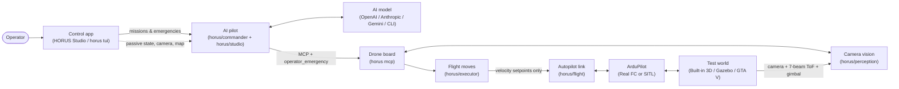

<div align="center">

# HORUS

**Safety-first, latency-tolerant autonomous drone supervision with ArduPilot and HORUS Studio.**

[](https://seros-cimenstein.github.io/horus-drone/)
[](.github/workflows/ci.yml)
[](pyproject.toml)
[](pyproject.toml)

</div>

HORUS lets a natural-language **AI model** supervise an **ArduPilot** multirotor over unreliable or high-latency links without ever trusting the LLM with flight stability, obstacle avoidance, or emergency overrides. Run everything locally in **HORUS Studio** with a built-in 3D **Test world**, or connect directly to real hardware.

---

## Quickstart

### From a local clone (recommended for development)

```sh
uv tool install --python 3.12 -e .
horus setup
horus
```

If you work inside a local virtualenv instead of `uv tool install`, run `.venv/bin/horus setup` and `.venv/bin/horus`.

### From GitHub (no manual clone needed)

Install on **Linux / macOS**:

```sh
curl -LsSf https://seros-cimenstein.github.io/horus-drone/install.sh | sh
```

Install on **Windows (PowerShell)**:

```powershell
irm https://seros-cimenstein.github.io/horus-drone/install.ps1 | iex
```

Or install directly from GitHub with `uv`:

```sh
uv tool install --python 3.12 git+https://github.com/seros-cimenstein/horus-drone.git
horus setup
horus
```

`horus` launches **HORUS Studio**—no Docker, Gazebo, GStreamer, or hand-edited YAML required. Pick **Indoor SAR Room**, **Outdoor Forest**, **Urban Plaza**, **Procedural World**, or **Real Drone** in one click.

---

## Highlights

- **Standalone 3D Test world (`#4e2c`):** Cross-platform Python/MuJoCo 3D simulation running real ArduCopter 4.7.1 SITL (`--model JSON`), 7-beam ToF proximity avoidance, stabilized 2-axis gimbal, textured SAR scenes, and an AprilTag precision landing pad.
- **HORUS Studio (`#63bb` / `#61d9`):** Unified web dashboard with live annotated camera, 3D spectator view, offline-capable Tactical 2D Map, Fault Lab (latency & AI link-cut simulator), Manual Flight Pad, and multi-provider AI setup (OpenAI, Anthropic, Gemini, OpenRouter, Ollama, Claude Code, OMP).
- **Latency-tolerant Camera vision (`#31b9`):** YOLOv8n + OSNet ReID set-of-mark numbered targets and CSRT ring-buffer fast-forward compensation (`point()`).
- **Bench to field (`#03a1`):** Connect USB/telemetry radios directly in Studio, deploy `horus mcp` (`pip install -e ".[board]"`) on companion computers, attach Gazebo/GTA V, or install the Tailscale phone PWA (`/?view=phone`).

---

## Architecture



> **Diagram & architecture reference:** See [`HORUS — Design Document v2.md`](HORUS%20%E2%80%94%20Design%20Document%20v2.md) for full block contracts and [`PLAN.md`](PLAN.md) for phase status.

---

## Safety Principles

1. **One base move at a time:** The **AI model** chooses one move (`take_off`, `goto`, `move`, `turn`, `look`, `hold`, `land`, `rth`). No autonomous search/chase loop runs behind the scenes.
2. **Velocity setpoints & deterministic avoidance:** **Autopilot link** sends `GUIDED` velocity setpoints only; **ArduPilot** enforces proximity braking via 7-beam ToF `DISTANCE_SENSOR` (`AVOID_ENABLE`). No artificial geofence is imposed.
3. **Instant operator priority:** `HOLD`, `LAND`, and `HOME` bypass the **AI pilot**, interrupt active model turns, and lock AI flight tools (`operator_lock`) until your next mission. Hardware RC `PILOT` override always wins.
4. **AI link-loss failsafe:** If the **AI model** / **AI pilot** goes quiet past `link_loss_rth_delay_s` (default 30 s), **Flight moves** holds and triggers `auto_rth`. Passive UI reads never keep the watchdog alive.

---

## Project Structure

Everything inside the repository maps cleanly to the HORUS architecture blocks above:

```text
horus-drone/
├── horus/                  # Main Python package
│   ├── cli.py              # `horus` CLI (studio, tui, mcp, setup, doctor)
│   ├── bootstrap.py        # ArduCopter SITL + YOLOv8n/OSNet asset fetcher & doctor
│   ├── studio/             # HORUS Studio supervisor, process manager, settings/secrets,
│   │                       #   capability checks, MCP config generator & Fault Lab shaper
│   ├── commander/          # AI pilot backend, FastAPI server, SSE stream & built UI (`web/`)
│   ├── repl/               # Terminal Control app (`horus tui`)
│   ├── mcp_server/         # Drone board MCP HTTP server (`horus mcp`)
│   ├── executor/           # Flight moves engine (single move, watchdog, operator_lock, auto_rth)
│   ├── flight/             # Autopilot link (MAVLink velocity setpoints & ArduPilot interface)
│   ├── perception/         # Camera vision (YOLOv8n + OSNet ReID, Set-of-Mark, CSRT, AprilTag)
│   ├── grounder/           # Optional VLM visual grounding service (Moondream / Qwen-VL / Gemini)
│   ├── gimbal/             # 2-axis gimbal stabilization & pointing
│   ├── tof_bridge/         # 7-beam ToF proximity bridge
│   ├── maps/ & own_map.py  # Offline tactical 2D maps & occupancy grid
│   └── world/              # Built-in Python/MuJoCo 3D Test world (4 scenes + JSON SITL runner)
│
├── ui/                     # React + TypeScript + Tailwind CSS + Vite source for HORUS Studio (builds to horus/commander/web/)
├── site/                   # Astro Starlight documentation website + install.sh / install.ps1
├── config/                 # YAML flight & sim profiles (horus.yaml, horus_gta.yaml, horus_nogps.yaml, ...)
├── sim/                    # Optional Docker + Gazebo Harmonic + ArduPilot SITL stack
├── gta/                    # Optional GTA V (Windows) bridge/mod for photorealistic simulation
├── scripts/                # Helper utilities (phone_serve.sh for Tailscale, start_grounder.sh, netem.sh, ...)
├── tests/                  # Pytest suite (world physics, Studio API, safety executor, MCP, CLI)
├── docs/                   # Course & PAF project deliverables (`docs/paf/`, separate from Starlight site)
├── .github/workflows/      # CI (`ci.yml`), docs deploy (`docs.yml`), asset releases (`release-assets.yml`)
├── pyproject.toml          # Package metadata, dependencies & `[board]` extra
├── HORUS — Design Document v2.md  # Full architecture & safety contract reference
└── PLAN.md                 # Phased roadmap & block tracking
```

---

## Documentation

Full guides and reference live at **[https://seros-cimenstein.github.io/horus-drone/](https://seros-cimenstein.github.io/horus-drone/)**:

| Topic | Link |
| --- | --- |
| Installation & `horus doctor` | [Installation](https://seros-cimenstein.github.io/horus-drone/getting-started/installation/) |
| Quickstart & Flight Deck | [Quickstart](https://seros-cimenstein.github.io/horus-drone/getting-started/quickstart/) |
| AI Providers & Crew | [AI Providers](https://seros-cimenstein.github.io/horus-drone/getting-started/ai-providers/) |
| Architecture & Safety Model | [Safety Model](https://seros-cimenstein.github.io/horus-drone/concepts/safety-model/) |
| Built-in 3D, Gazebo & GTA V | [Built-in 3D World](https://seros-cimenstein.github.io/horus-drone/simulation/builtin-3d/) |
| Companion Board & Phone PWA | [Companion Setup](https://seros-cimenstein.github.io/horus-drone/hardware/companion-setup/) |
| MCP Tools, CLI & Fault Lab | [MCP Tools](https://seros-cimenstein.github.io/horus-drone/reference/mcp-tools/) |
| Credits & Licenses | [Credits & Licenses](https://seros-cimenstein.github.io/horus-drone/reference/credits-and-licenses/) |
